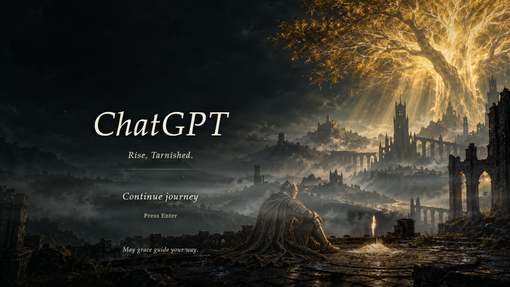
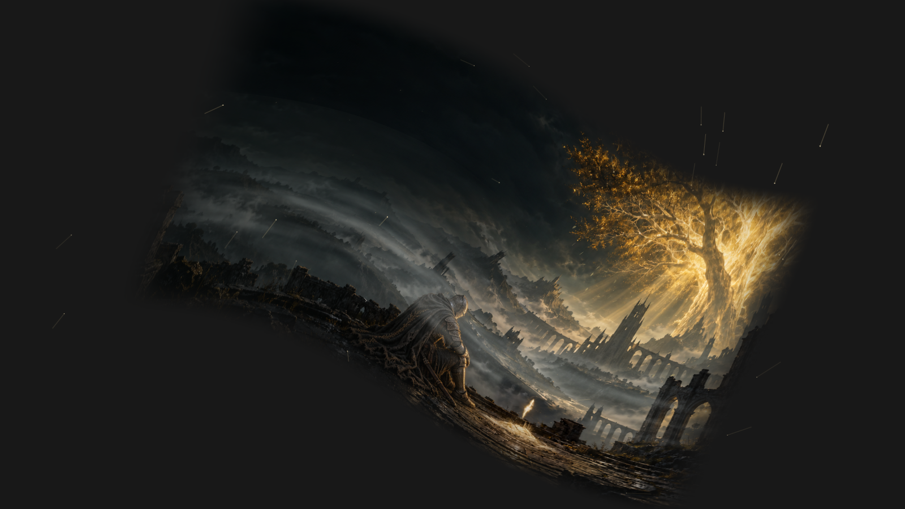
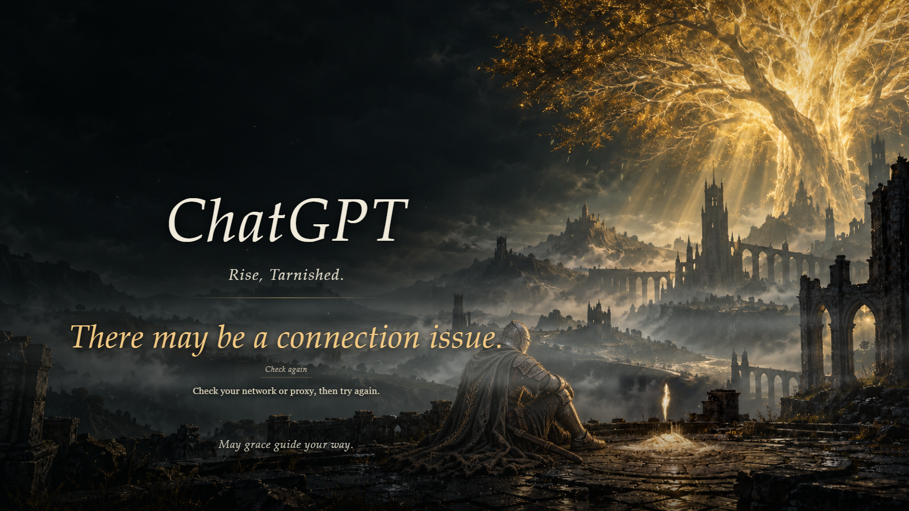

# ChatGPT — Elden Ring Entry Animation

**An Elden Ring-inspired entry animation and startup launcher for ChatGPT on Windows.**

A quiet moment beside grace before your next conversation. Golden leaves drift through ruined towers, sparks rise beside a seated Tarnished, and the scene curls away when you continue into ChatGPT.

This project is a small, local Windows companion that sits in front of ChatGPT during startup. It supports the Codex experience inside the app, and Setup can also select a separately packaged Codex installation. It waits for a usable chat editor, lets you enter with a click or Enter, and then closes its own animation processes. Your installed app, account, and conversations stay in the official app.

## Preview

**The startup scene while loading.** The sample frame shows the thin estimated progress bar; leaves, mist, motes, and grace sparks continue looping while you wait.



**The entry transition.** The lettering retires first, the landscape curls inward with 84 golden meteor trails, and a soft fade reveals the actual app. This image is one frame sampled from that transition.



**When startup takes longer.** A large, warm-gold message highlights a possible connection issue. The screen offers **Check again** and keeps entry unavailable until a usable editor is confirmed.



[Download the Windows release](https://github.com/max12211405/chatgpt-elden-ring-loader/releases/latest) · [Music setup](docs/MUSIC.md) · [Compatibility and troubleshooting](docs/COMPATIBILITY.md)

## What it does

- Plays a local, looping startup scene while the actual app opens underneath it.
- Adds falling golden leaves, drifting motes, mist, and small grace sparks with a fixed camera.
- Shows a thin gold loading bar with uniform integer percentages and smooth, device-adaptive pacing.
- Shows **Continue journey** and **Press Enter** once a usable chat editor is detected.
- Replaces a prolonged loading estimate with a prominent connection hint and a readiness-only retry.
- Accepts one click or one Enter press, then curls the scene into a gradual reveal of the real app.
- Skips the animation and music when the configured app's main process is already running.
- Releases the animation's WebView processes after entry. It does not remain as a background wallpaper.
- Supports optional local music: every pass begins at **00:15**, then fades out and stops before handoff.
- Keeps the native Windows title bar and close button. Closing the loader does not quit ChatGPT.

This is a standalone companion launcher. It does not modify, patch, or replace the official Codex or ChatGPT application.

## How a launch works

| Situation | What you see | What happens underneath |
| --- | --- | --- |
| The app was fully exited | The opening scene and looping ambience | The companion starts your installed app and checks for a usable editor. |
| The editor becomes ready | **Continue journey** and **Press Enter** | The scene keeps playing until you choose to continue. |
| You click Continue or press Enter once | A scene-curl transition and gradual reveal | Optional music fades out, the real app receives focus, and the companion releases its resources. |
| The app is still running in the background | The official app opens directly | The companion skips the scene, music, and WebView startup. |

The loading percentage is an **estimate**, based on observed startup stages and recent successful startup times on that machine. ChatGPT does not expose an internal loading percentage. The bar moves smoothly between safe stage limits and reaches **100% only after a usable editor is confirmed**. A slow machine is allowed to take longer; the estimate never grants entry by itself.

If no usable editor is detected after 30 seconds, the progress estimate pauses and disappears. A large **There may be a connection issue.** message asks you to check your network or proxy. **Check again** restarts the readiness check; it does not bypass it or enter an unready app. The warning is a troubleshooting hint based on delayed readiness, not a network test: slow startup, a sign-in screen, or an accessibility change can also trigger it. Once the editor is confirmed, normal progress and entry controls return.

Each accessibility check runs in an owned, hidden helper with a five-second timeout, so a stuck provider does not leave an endless scan running. Closing the loader cancels its helper. The companion cannot repair the official app's connection or sign-in problems.

## Quick start

1. Install and open the official Windows Codex or ChatGPT app at least once.
2. Download the **Windows x64 ZIP** from [Releases](https://github.com/max12211405/chatgpt-elden-ring-loader/releases), then extract the whole folder to a writable location you intend to keep.
3. Double-click **Setup.cmd**. It detects installed packaged apps, lets you choose when several match, and creates **ChatGPT - Elden Ring** on your desktop.
4. Open that new shortcut. Your original shortcut is left untouched.

The prebuilt release needs no Python, Node.js, Git, or Visual Studio. It requires **64-bit Windows 10/11, .NET Framework 4.8, and Microsoft Edge WebView2 Runtime**. See [compatibility](docs/COMPATIBILITY.md) for the supported installation types and runtime checks.

If the app is still running in the system tray, opening the shortcut goes straight back to it. To see the scene on the next normal launch, use the official app's own **Exit/Quit** command first. For a preview without quitting your conversation, run:

```powershell
.\ChatGPTGraceLauncher.exe --demo
```

## Optional menu music

The music file is **not included**. To match the intended atmosphere, search for:

| Field | Value |
| --- | --- |
| Track | **Elden Ring** |
| Artist / composer | **Tsukasa Saitoh** |
| Album | **Elden Ring (Original Soundtrack)** |
| Search phrase | `Tsukasa Saitoh Elden Ring Original Soundtrack` |

Obtain your own legitimate local MP3, name it **menu-music.mp3**, and put it in the release's **media** folder beside the executable:

```text
ChatGPT-Elden-Ring-Loader/
  ChatGPTGraceLauncher.exe
  startup.html
  media/
    menu-music.mp3
```

The launcher automatically starts at **00:15**, returns to **00:15** after every completed pass, and fades to silence when you enter the app. It also works without any audio file. A streaming subscription or a track link is not a local MP3; no download or DRM-removal tool is provided.

The track identification is linked to its [Apple Music catalog entry](https://music.apple.com/us/song/1642388052). Full instructions are in [MUSIC.md](docs/MUSIC.md).

## Build from source

Build on Windows x64 with Python 3 and .NET Framework 4.8 installed:

```powershell
git clone https://github.com/max12211405/chatgpt-elden-ring-loader.git
cd chatgpt-elden-ring-loader
.\scripts\build.ps1
```

The build restores the pinned WebView2 SDK from NuGet, verifies its SHA-256, compiles the native host with the Windows .NET compiler, and builds the local scene using Python's standard library. Output goes to `dist/AtGrace`. SDK downloads require an internet connection during the first build; playback and handoff are local.

For an offline build, supply an already downloaded, matching SDK package:

```powershell
.\scripts\build.ps1 -SdkPackage C:\Downloads\microsoft.web.webview2.1.0.4314.35.nupkg
```

No Microsoft font files are redistributed. The scene uses locally installed serif fonts with fallbacks.

## Verify changes

```powershell
.\scripts\test-native.ps1
npm install
npx playwright install chromium
npm test
```

Native tests cover readiness, safe recovery, helper timeout/cancellation, duplicate entry, process-role detection, delayed foreground activation, target replacement, gradual reveal, settings validation, and physical screen-edge layout. Browser tests exercise the actual built page, keyboard entry, continuous progress, different startup speeds, readiness loss during entry, renderer preparation after cancellation, graphics fallback, and music lifecycle. Music tests generate their own sine-wave fixture.

To create a clean release ZIP after building, run `python scripts/package.py`. The packager uses an explicit file list and excludes local music, settings, browser cache, logs, crash dumps, and personal shortcuts.

These automated checks do not replace a real cold-start/handoff test on each target PC. The new recovery implementation has not yet completed a fresh physical cold-start verification or a second-computer test. These tests do not certify every Windows display driver or future official app version. See the compatibility notes before reporting a platform-specific issue.

## Project layout

| Path | Purpose |
| --- | --- |
| `src/native` | WinForms/WebView2 host, app detection, readiness, window reveal |
| `src/web` | Scene template, particles, music lifecycle, WebGL curl |
| `assets` | AI-assisted scene artwork and localized grace patch |
| `scripts` | Reproducible build and native test runner |
| `tests` | Native and browser regression checks |
| `vendor` | html2canvas and required third-party notices |

## Remove it

Close the loader, delete the **ChatGPT - Elden Ring** shortcut, and remove its extracted folder. If upgrading from an older release, remove its separate **ChatGPT - At Grace** shortcut too. The official app and your original shortcut are independent of this project. Locally generated WebView cache and `launcher.log` live inside the extracted folder.

## License and credits

Original source code is available under the [MIT License](LICENSE). See [THIRD_PARTY_NOTICES.md](THIRD_PARTY_NOTICES.md) for dependencies, artwork scope, trademarks, and music exclusions.

This is an unofficial fan project. It is not affiliated with or endorsed by OpenAI, FromSoftware, or Bandai Namco. ELDEN RING, Codex, ChatGPT, and their respective marks belong to their owners.
